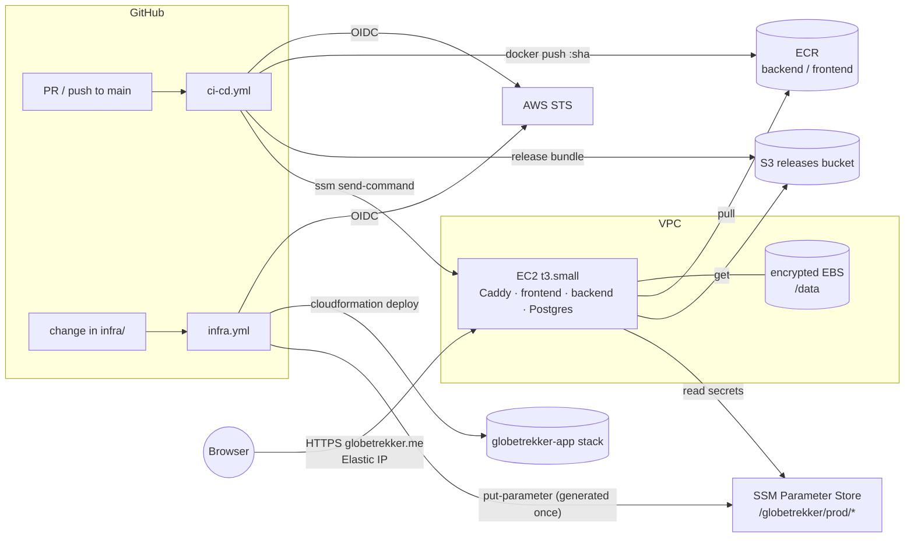

# Globetrekker — Deployment

How Globetrekker gets from a `git push` to running at https://globetrekker.me on AWS. For the
day-to-day process (what triggers what, approvals, rollbacks) see
[`release-process.md`](release-process.md). For the templates themselves see
[`infra/cloudformation/README.md`](../infra/cloudformation/README.md).

## Two workflows, two concerns

| Concern | Workflow | Runs when | AWS role |
| --- | --- | --- | --- |
| **Infrastructure:** VPC, EC2, Elastic IP, data volume, ECR, release bucket, IAM, secrets | `.github/workflows/infra.yml` | A change under `infra/` is merged to `main`, or a manual run | `github-actions-globetrekker-infra` |
| **Application:** test, build images, ship a release to the running instance | `.github/workflows/ci-cd.yml` | Every PR (tests only) and every push to `main` (tests → images → deploy), or a manual run / rollback | `github-actions-globetrekker-deploy` |

They are separate on purpose:
- **Code deploys never touch infrastructure.** Shipping a release only pulls new images on the existing instance.
- **Infrastructure changes are rare, reviewed and serialised.** The infra workflow never runs two changes at once.
- **Least privilege.** The two roles have different permissions: the deploy role can't change infrastructure, and the infra role can't deploy code.

Only one thing is done by hand, once: the **bootstrap stack**. It creates the GitHub OIDC login
and the two roles; without it GitHub can't authenticate to AWS at all.

## Architecture



### What the app stack creates (`infra/cloudformation/app.yaml`)

| Resource | Notes |
| --- | --- |
| VPC, public subnet, internet gateway, route table | Self-contained: nothing to look up in the account first. |
| Security group | Inbound **80, 443/tcp, 443/udp only**. No SSH port; shell access is through SSM Session Manager. |
| EC2 instance (Amazon Linux 2023, `t3.small` by default) | Requires IMDSv2, encrypted root disk. First boot installs Docker and Compose, mounts the data volume and creates `/opt/globetrekker`. It never builds or runs app code itself. |
| Data volume (gp3, encrypted, 20 GiB) | Mounted at `/data`, which holds Docker's data root and therefore the Postgres volume. It's **snapshotted** if the stack replaces or deletes it, so an instance replacement doesn't lose data. |
| Elastic IP | Stable address for the DNS `A` records. |
| ECR repos `globetrekker-backend`, `globetrekker-frontend` | Immutable tags (the commit SHA), scanned on push, keep the newest 30 images. Retained if the stack is deleted. |
| S3 bucket `globetrekker-releases-<account>-<region>` | Private and encrypted. Holds **deploy artifacts only** (each release's compose files, Caddyfile and deploy script), never user content. Expires after 180 days. |
| Instance role | SSM agent, read `/globetrekker/prod/*` parameters, pull from the two ECR repos, read release bundles. Capped by the bootstrap's permissions boundary. |

### Secrets

Production secrets live in **SSM Parameter Store** under `/globetrekker/prod/`:

| Parameter | Created by | Notes |
| --- | --- | --- |
| `POSTGRES_PASSWORD` (SecureString) | `infra.yml`, generated with `openssl rand` on first run | Never rotated automatically: changing it would lock the app out of its existing database. |
| `JWT_SECRET` (SecureString) | `infra.yml`, generated on first run | Rotating it logs everyone out. |
| `ACME_EMAIL` | `infra.yml`, from the repo variable `ACME_EMAIL` | Let's Encrypt contact address. |

Secret values never appear in GitHub (not in secrets, logs or SSM command text). On each deploy the instance reads them
itself and writes a `chmod 600` `.env` file next to the release.

## How a deploy works

1. **Tests:** unit, integration and e2e (see [`testing.md`](testing.md)).
2. **Images:** CI builds the `prod` targets of `be/` and `fe/` and pushes them to ECR, tagged with the commit SHA. The images that ship are exactly the ones CI built, so the instance never builds code.
3. **Bundle:** CI uploads `docker-compose.yml`, `docker-compose.prod.yml`, `Caddyfile` and `deploy/remote-deploy.sh` to `s3://…/releases/<sha>.tar.gz`.
4. **SSM Run Command:** the instance downloads the bundle into `/opt/globetrekker/releases/<sha>` and runs [`deploy/remote-deploy.sh`](../deploy/remote-deploy.sh), which:
   - writes `.env` from Parameter Store, with `BACKEND_IMAGE` and `FRONTEND_IMAGE` pinned to `<sha>`;
   - logs in to ECR with the instance role and pulls the images;
   - runs `docker compose up -d --no-build`, so the `migrate` service applies Alembic migrations **before** the backend starts;
   - waits up to 5 minutes for the backend health check and a clean `migrate` exit;
   - **on success**, points `/opt/globetrekker/current` at the release, keeps the 5 newest releases on disk and prunes unused images;
   - **on failure**, prints the logs, **restarts the previous release automatically**, and exits non-zero so the GitHub job fails.
5. **Public check:** if the repo variable `APP_URL` is set, CI polls `APP_URL/api/ready`.

Caddy (in the stack) obtains and renews the Let's Encrypt certificate for `globetrekker.me` once DNS points at the Elastic IP.

The deploy script was rehearsed locally before it was committed. A local registry and a fake `aws` command stood in for ECR and Parameter Store. A good release went live, and a deliberately broken release was detected and rolled back to the previous one automatically.

## Why OIDC and SSM

- **No AWS keys in GitHub.** Each job exchanges a short-lived GitHub OIDC token for temporary AWS credentials. The role ARNs are stored as plain repository variables because they aren't secrets: the trust policies decide who may use them.
  - **Infra role:** only a job running in the GitHub environment `infrastructure` of `sushantmagoo/globetrekker`.
  - **Deploy role:** only jobs on `main` or in the `production` environment of that repo.
  - Forks and other branches can't use either role.
- **No SSH.** No key material exists anywhere and port 22 is closed. Deploys use SSM Run Command, and humans use `aws ssm start-session --target <instance-id>`.

### What each role can do

| | Infra role | Deploy role |
| --- | --- | --- |
| CloudFormation | Full control of **only** the `globetrekker-app` stack | Read its outputs |
| EC2 / VPC | `ec2:*` limited to the configured region (EC2 can't be scoped per resource for create) | `DescribeInstances` |
| IAM | Create and manage roles and instance profiles named `globetrekker-*`, **only with the `globetrekker-instance-boundary` permissions boundary**. Pass them to EC2 only, never remove the boundary. | None |
| ECR | Manage `globetrekker-*` repositories | Push and pull images in them |
| S3 | Manage `globetrekker-releases-*` buckets | Put and get `releases/*` objects |
| SSM | Write `/globetrekker/*` parameters; read the public AMI parameter | `SendCommand` (AWS-RunShellScript only) to the instance tagged `globetrekker-app` |

The permissions boundary is what stops a malicious template change from escalating. Even if
someone edits `app.yaml` to give the instance role `AdministratorAccess`, the boundary limits it to
SSM agent, ECR pull, release-bundle reads and `/globetrekker/*` parameters. The CI roles
themselves are named `github-actions-globetrekker-*`, outside the `globetrekker-*` pattern, so the
infra role cannot modify them.

## One-time setup

You need the AWS CLI with **admin credentials** (only for step 1) and `gh`.

1. **Bootstrap the OIDC roles** (from the repo root):
   ```bash
   aws cloudformation deploy --region us-east-1 \
     --template-file infra/cloudformation/bootstrap.yaml \
     --stack-name globetrekker-bootstrap \
     --capabilities CAPABILITY_NAMED_IAM \
     --parameter-overrides GitHubOrg=sushantmagoo GitHubRepo=globetrekker
   aws cloudformation describe-stacks --region us-east-1 --stack-name globetrekker-bootstrap \
     --query 'Stacks[0].Outputs' --output table
   ```
   If the account already has a GitHub OIDC provider, add `CreateOidcProvider=false`.

2. **Configure GitHub** (repository variables and environments):
   ```bash
   R=sushantmagoo/globetrekker
   gh variable set AWS_REGION        -R $R --body us-east-1
   gh variable set AWS_INFRA_ROLE_ARN  -R $R --body <InfraRoleArn output>
   gh variable set AWS_DEPLOY_ROLE_ARN -R $R --body <DeployRoleArn output>
   gh variable set ACME_EMAIL        -R $R --body <your contact email>
   gh api -X PUT repos/$R/environments/infrastructure >/dev/null
   gh api -X PUT repos/$R/environments/production >/dev/null
   ```
   Optional variables:
   - `INSTANCE_TYPE` (default `t3.small`)
   - `DATA_VOLUME_SIZE` (default 20)
   - `APP_URL` (e.g. `https://globetrekker.me`). Set it once DNS works, to turn on the public health check.

   Recommended: in **Settings → Environments**, restrict both environments to the `main` branch, and add yourself as a required reviewer on `infrastructure` (and on `production` if you want to approve every release).

3. **Create the infrastructure:** run **Actions → Infrastructure → Run workflow** on `main`. The job summary shows the Elastic IP.

4. **DNS:** at your registrar, point `A` records for `globetrekker.me` and `www.globetrekker.me` at that IP.

5. **First release:** push to `main`, or run **Actions → CI/CD → Run workflow**. Once DNS has propagated, Caddy gets the certificate and the site is live. Then set `APP_URL`.

## Operating the server

```bash
ID=$(aws cloudformation describe-stacks --stack-name globetrekker-app \
  --query "Stacks[0].Outputs[?OutputKey=='InstanceId'].OutputValue" --output text)
aws ssm start-session --target "$ID"          # shell, no SSH needed
# on the instance:
cat /opt/globetrekker/CURRENT_RELEASE
cd /opt/globetrekker/current && sudo docker compose --env-file .env -f docker-compose.yml -f docker-compose.prod.yml ps
sudo docker compose --env-file .env -f docker-compose.yml -f docker-compose.prod.yml logs -f backend
```

## What this does not do (yet)

- **Downtime.** There is no zero-downtime deploy: one instance, and containers are recreated in place, typically a few seconds of 502s.
- **Single point of failure.** One instance in one availability zone. The data volume is snapshotted on replacement, but there are **no scheduled backups** yet (issue #4).
- **No staging environment.** Releases go straight from CI to production.
- **Secret rotation is manual.** See "Rotating secrets" in [`release-process.md`](release-process.md).
- **DNS isn't managed** (no Route 53). The two `A` records are set by hand once.
- **Monitoring and alerting** is not in place (issue #5). Container logs stay on the instance (rotated at 10 MB × 3).
