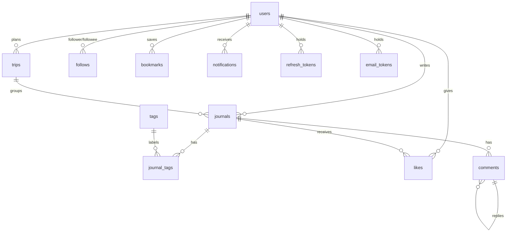

# Globetrekker — Technical Specification

> **Globetrekker** (https://globetrekker.me) is a journaling app and social network for travellers.
> People write rich travel journals in a WYSIWYG editor, save them as drafts or publish them, and
> share them with the world, with their followers, or with anyone who has a private link.

| Layer     | Stack                                              | Folder |
| --------- | -------------------------------------------------- | ------ |
| Frontend  | React + TypeScript + Vite + Ant Design + TipTap     | `fe/`  |
| Backend   | Python + FastAPI + SQLAlchemy (async) + Alembic     | `be/`  |
| Database  | PostgreSQL                                          | `db/`  |
| Edge      | Caddy (automatic HTTPS for `globetrekker.me`)       | root   |

---

## Table of contents

1. [Product scope](#1-product-scope)
2. [System architecture](#2-system-architecture)
3. [Frontend](#3-frontend)
4. [Backend](#4-backend)
5. [Database](#5-database)
6. [Infrastructure and deployment](#6-infrastructure-and-deployment)
7. [Security](#7-security)
8. [Testing and quality](#8-testing-and-quality)
9. [Roadmap](#9-roadmap)

---

## 1. Product scope

### 1.1 Roles
- **Visitor** (anonymous): reads public journals and profiles, browses Explore, opens share links.
- **Member**: everything a visitor can do, plus writing journals, following people, and liking, commenting on, and bookmarking journals.
- **Admin**: moderation (hide content, suspend users) through admin-only API endpoints.

### 1.2 MVP features
1. **Accounts**: sign up with email and password, email verification, log in and out, forgot and reset password.
2. **Journal editor** (the core feature):
   - Title and optional subtitle.
   - Rich text: H2 and H3 headings, bold, italic, underline, strike, highlight, links, lists, blockquote,
     divider, inline code, text alignment, YouTube and Vimeo embeds.
   - Travel metadata: location (map place picker), travel start and end dates, tags, and an optional trip.
   - **Autosave** for drafts, plus local recovery if the browser crashes.
   - **Visibility**: `public`, `followers`, `unlisted` (anyone with the link), `private`.
   - Preview, publish, unpublish.
3. **Reading**: a typography-first reader with a title header, map pin, trip dates, author card, likes, comments, bookmark, and share.
4. **Sharing**: canonical URL `https://globetrekker.me/j/{slug}`; unlisted links carry a rotatable
   token (`?t=…`); a Web Share API or share modal (copy link, X, Facebook, WhatsApp, Telegram, email);
   rich link previews through Open Graph and Twitter cards.
5. **Social**: follow and unfollow, a home feed of people you follow, Explore (trending, recent, by
   tag or country, full-text search), likes, threaded comments (one reply level), bookmarks, notifications.
6. **Profiles**: generated initials avatar (antd `Avatar` with a colour derived from the username),
   display name, `@username`, bio, home country, website, a "places visited" world map, a journals tab, and a trips tab.
7. **Trips**: a named trip (e.g. "Patagonia 2026") that groups journals in order.
8. **Settings**: profile, email and password, default visibility, account deletion.

### 1.3 Out of scope for MVP
- File uploads of any kind (images, avatars, attachments), and therefore any object storage.
- A cache layer.
- Native mobile apps, real-time chat, collaborative editing, offline-first sync, monetisation.

---

## 2. System architecture

```
                         ┌──────────────────────── Docker host ─────────────────────────┐
 Browser ──HTTPS──► Caddy│ globetrekker.me                                              │
                         │   /api/*            ──► backend  (FastAPI, uvicorn) ──► postgres
                         │   /j/* /u/* (bots)  ──► backend  (Open Graph HTML)            │
                         │   /*                ──► frontend (nginx, static SPA)          │
                         └───────────────────────────────────────────────────────────────┘
```

- **Same origin**: the SPA and API are both served from `globetrekker.me` (API under `/api`), so there is no CORS
  in production and the refresh cookie stays first-party.
- **Stateless API**: every API instance is interchangeable. All persistent state lives in Postgres.
- There are three runtime services: **Caddy**, **frontend**, and **backend**, plus **Postgres**.

---

## 3. Frontend

### 3.1 Stack

| Concern         | Choice                                                         |
| --------------- | -------------------------------------------------------------- |
| Language        | TypeScript (strict)                                            |
| Framework       | React (latest stable), function components and hooks           |
| Build           | Vite                                                           |
| UI library      | Ant Design (`antd`, latest stable major) + `@ant-design/icons` |
| WYSIWYG editor  | TipTap (ProseMirror), styled to match antd                     |
| Routing         | React Router (data router)                                     |
| Server state    | TanStack Query                                                 |
| Client state    | Zustand (session and UI preferences only)                      |
| Forms           | antd `Form`                                                    |
| Maps            | Leaflet + `react-leaflet`, OpenStreetMap tiles                 |
| Dates           | `dayjs`                                                        |
| i18n            | `react-i18next` (English first; every string goes through `t()`) |
| Sanitisation    | `DOMPurify` (defence in depth; the server sanitises too)       |
| Tests           | Vitest + React Testing Library, Playwright for e2e             |
| Lint            | oxlint (Vite's default; React and TypeScript plugins)          |
| Package manager | npm                                                            |

### 3.2 Routes

| Path                              | Page                                      | Access  |
| --------------------------------- | ----------------------------------------- | ------- |
| `/`                               | Home feed (member) or Explore (visitor)   | any     |
| `/explore`                        | Explore and search                        | any     |
| `/login`, `/signup`               | Auth                                      | guest   |
| `/verify-email`                   | Email verification                        | any     |
| `/forgot-password`, `/reset-password` | Password recovery                     | guest   |
| `/write`                          | Creates a draft, then redirects to the editor | member |
| `/write/:id`                      | Editor (by journal id, which stays stable while the draft's slug follows its title) | owner |
| `/j/:slug`                        | Journal reader                            | per visibility |
| `/u/:username`                    | Profile                                   | any     |
| `/u/:username/trips/:tripSlug`    | Trip                                      | any     |
| `/me/drafts`, `/me/bookmarks`     | My drafts and bookmarks                   | member  |
| `/notifications`                  | Notifications                             | member  |
| `/settings/*`                     | Settings                                  | member  |

Guards run in route loaders (`requireAuth`, `requireGuest`). Pages are lazy-loaded.
The marketing site lives separately in `landing_page/`.

### 3.3 Editor (TipTap)
- **Canonical format**: ProseMirror JSON (`content_json`). The editor loads and saves only this format.
- The server derives **sanitised HTML** (`content_html`) and **plain text** from it. The reader renders
  `content_html`, so readers never download the editor bundle (it is code-split).
- Extensions: StarterKit, Underline, Link (`rel="noopener nofollow ugc"`), Youtube (with Vimeo support),
  Placeholder, CharacterCount, TextAlign, Highlight, Typography.
  There is **no image node**. Pasted or dropped files and pasted `` tags are stripped.
- UI: an antd toolbar (Buttons, Dropdowns, Tooltips), a `BubbleMenu` for inline marks, and a `FloatingMenu` for inserting blocks.
- **Autosave**: changes are debounced by 2 s and sent as `PATCH /journals/{id}` with the current `version`
  (optimistic concurrency). On a `409` conflict the user can reload or overwrite.
  The editor shows a status of Saving, Saved, or Offline (retrying). `Ctrl/Cmd+S` forces a save.
- **Local recovery**: the unsaved state is mirrored to `localStorage` per journal ID and offered back on load.

### 3.4 Data and auth
- `VITE_API_BASE_URL` defaults to `/api/v1`. In dev, Vite proxies `/api` to the backend container.
- **Access token** (JWT, 15 min) lives in memory only. **Refresh token** is an httpOnly cookie.
  On boot and on any `401`, the client makes a single-flight `POST /auth/refresh`, then retries the request.
- Lists use `useInfiniteQuery` with cursor pagination. Likes, follows, and bookmarks update optimistically.
- API errors follow RFC 9457 `problem+json`: field errors go to `Form.setFields`, and the rest go to antd `notification`.
- API types live in `src/api/types.ts` and mirror the backend schemas. (`openapi-typescript` doesn't support TypeScript 7 yet; switch to generated types once it does.)

### 3.5 UI and design
- antd `ConfigProvider` theme taken from the logo: primary `#4F7A28` (logo green, darkened for AA contrast; `#9BC068` in dark mode), sun yellow `#E8D86A` for accents. Inter for UI, Lora (serif) for journal bodies, Cormorant Garamond for the wordmark.
- Light and dark themes (`theme.darkAlgorithm`) follow the system setting, with a user toggle.
- Layout: a header (logo, search, **Write**, notifications, avatar menu) with a 720 px reading column
  and a 1200 px feed grid. Below the `md` breakpoint, a bottom tab bar replaces the header nav.
- Journal cards are text-first: the title, excerpt, location, country flag emoji, dates, and author.
  A small static map thumbnail appears when the journal has a location.
- Accessibility target: WCAG 2.2 AA.
- Performance budget: initial JS ≤ 250 KB gzip (excluding the editor chunk), LCP < 2.5 s on 4G.

### 3.6 Structure

```
fe/
├── Dockerfile  nginx.conf  index.html  package.json  vite.config.ts  tsconfig.json
├── public/                      # favicon, robots.txt, manifest, og-default.png
└── src/
    ├── main.tsx  router.tsx
    ├── api/                     # client.ts + per-resource modules
    ├── components/              # AppLayout, JournalCard, ShareModal, …
    ├── features/                # auth, editor, journals, feed, profile, trips, notifications, settings
    ├── hooks/  stores/  theme/  i18n/  utils/
    └── types/api.ts             # generated
```

### 3.7 Build-time env

| Variable              | Local default            | Prod                       |
| --------------------- | ------------------------ | -------------------------- |
| `VITE_API_BASE_URL`   | `/api/v1`                | `/api/v1`                  |
| `VITE_PUBLIC_APP_URL` | `http://localhost:5173`  | `https://globetrekker.me`  |
| `VITE_PROXY_TARGET`   | `http://backend:8000`    | — (dev only)               |

npm scripts: `dev`, `build`, `preview`, `lint`, `typecheck`, `test`.

---

## 4. Backend

### 4.1 Stack

| Concern          | Choice                                                    |
| ---------------- | --------------------------------------------------------- |
| Runtime          | Python 3.13                                               |
| Framework        | FastAPI, served by uvicorn                                |
| Validation       | Pydantic v2, `pydantic-settings` for config               |
| ORM and driver   | SQLAlchemy 2.0 (async) + `asyncpg`                        |
| Migrations       | Alembic                                                   |
| Auth             | `PyJWT`, `pwdlib[argon2]` (Argon2id)                       |
| HTML sanitising  | `nh3` (strict allowlist; no ``)                      |
| Rate limiting    | `slowapi` with in-memory storage (see §4.4)               |
| Email            | SMTP (`aiosmtplib`), Jinja2 templates; Mailpit locally    |
| Background work  | FastAPI `BackgroundTasks` (emails); scheduled jobs via a CLI entrypoint (§4.9) |
| Observability    | `structlog` JSON logs, request IDs, optional Sentry, Prometheus `/metrics` |
| Tests            | pytest, pytest-asyncio, httpx `AsyncClient`, testcontainers (Postgres) |
| Lint and types   | Ruff (lint and format), mypy (strict on `app/`)           |
| Package manager  | uv (`pyproject.toml` + `uv.lock`, `[tool.uv] package = false`) |

### 4.2 Structure

```
be/
├── Dockerfile  pyproject.toml  uv.lock  alembic.ini
├── alembic/versions/
├── app/
│   ├── main.py                 # app factory, middleware, routers
│   ├── core/                   # config.py, security.py, logging.py, errors.py, ratelimit.py
│   ├── db/                     # session.py (async engine), base.py (naming conventions)
│   ├── models/                 # SQLAlchemy models (one file per aggregate)
│   ├── schemas/                # Pydantic request and response models
│   ├── api/v1/                 # routers: auth, users, journals, trips, social, feed, search, notifications, og, admin
│   ├── services/               # business logic (routers stay thin)
│   ├── content/                # ProseMirror JSON → HTML/text, sanitiser, excerpt, reading time
│   ├── email/                  # sender + templates
│   └── jobs/                   # scheduled maintenance (python -m app.jobs <name>)
└── tests/
```

Layering: **router → service → repository/ORM**. Routers handle HTTP only; services own transactions and rules.

### 4.3 Configuration (env)

| Variable                  | Example / notes                                              |
| ------------------------- | ------------------------------------------------------------ |
| `APP_ENV`                 | `local` or `production`                                      |
| `DATABASE_URL`            | `postgresql+asyncpg://user:pass@db:5432/globetrekker`        |
| `JWT_SECRET`              | ≥ 32 random bytes                                            |
| `ACCESS_TOKEN_TTL_MIN`    | `15`                                                         |
| `REFRESH_TOKEN_TTL_DAYS`  | `30`                                                         |
| `PUBLIC_APP_URL`          | `https://globetrekker.me`                                    |
| `CORS_ORIGINS`            | Empty in prod (same origin), `http://localhost:5173` locally |
| `SMTP_HOST`, `SMTP_PORT`, `SMTP_USER`, `SMTP_PASSWORD`, `MAIL_FROM` | `no-reply@globetrekker.me` |
| `WEB_CONCURRENCY`         | uvicorn worker count in prod (default `4`)                   |
| `SENTRY_DSN`              | optional                                                     |

### 4.4 Authentication
- Email and password sign-up. Passwords are hashed with Argon2id and must be at least 10 characters (checked against a common-password list).
- **Access token**: a JWT (HS256, 15 min) with claims `sub`, `role`, `iat`, `exp`, `jti`, sent as `Authorization: Bearer`.
- **Refresh token**: 256 random bits, stored **hashed** in `refresh_tokens`, sent as cookie
  `gt_refresh` (`HttpOnly; Secure; SameSite=Lax; Path=/api/v1/auth`). Tokens **rotate on every use**.
  Reusing a rotated token revokes the whole token family (theft detection).
- Email verification and password reset use single-use, hashed, expiring tokens (`email_tokens`, 24 h and 1 h respectively).
- Unverified users can write drafts but cannot publish or comment.
- **Rate limits** (`slowapi`, in-memory, keyed on the client IP from `X-Forwarded-For` set by Caddy):
  login 5/min per IP+email, sign-up 3/h per IP, password reset 3/h per email, writes 60/min per user.
  Counters are per worker process, so the effective limit is up to `WEB_CONCURRENCY` times the
  configured value. This is acceptable for MVP.
  Brute-force protection on login does not depend on these counters: it is enforced in Postgres via
  `users.failed_login_count` and `users.locked_until` (10 failures locks the account for 15 minutes).

### 4.5 API (v1, prefix `/api/v1`)

Conventions:
- JSON with snake_case fields.
- Cursor pagination: `?cursor=&limit=` (max 50) returns `{ items, next_cursor }`.
- Errors use `application/problem+json`.
- OpenAPI is served at `/api/openapi.json` and docs at `/api/docs` (docs are local only).

**Auth**
| Method | Path                            | Description                       |
| ------ | ------------------------------- | --------------------------------- |
| POST   | `/auth/signup`                  | Create account and send verification email |
| POST   | `/auth/login`                   | Returns access token and sets refresh cookie |
| POST   | `/auth/refresh`                 | Rotate refresh token and return a new access token |
| POST   | `/auth/logout`                  | Revoke the current refresh family |
| POST   | `/auth/verify-email`            | `{ token }`                       |
| POST   | `/auth/resend-verification`     |                                   |
| POST   | `/auth/forgot-password`         | Always returns 202 (prevents account enumeration) |
| POST   | `/auth/reset-password`          | `{ token, new_password }`         |

**Users and profiles**
| Method | Path                                   | Description                 |
| ------ | -------------------------------------- | --------------------------- |
| GET    | `/me`                                  | Current user + settings     |
| PATCH  | `/me`                                  | Update profile and settings |
| PATCH  | `/me/password`                         | Change password             |
| DELETE | `/me`                                  | Delete account (soft delete, then purge after 30 days) |
| GET    | `/users/{username}`                    | Public profile + counts + `is_following` |
| GET    | `/users/{username}/journals`           | Journals visible to the viewer |
| GET    | `/users/{username}/trips`              | Trips                       |
| GET    | `/users/{username}/places`             | Aggregated visited places (for the world map) |
| GET    | `/users/{username}/followers` · `/following` | Lists                 |
| PUT / DELETE | `/users/{username}/follow`       | Follow / unfollow (idempotent) |

**Journals**
| Method | Path                                   | Description                 |
| ------ | -------------------------------------- | --------------------------- |
| POST   | `/journals`                            | Create an empty draft and return `{ id, slug, version }` |
| GET    | `/journals/{slug}`                     | Read (visibility enforced; `?t=` share token for unlisted) |
| GET    | `/journals/{id}/edit`                  | Owner: full payload including `content_json` |
| PATCH  | `/journals/{id}`                       | Partial update; requires `version`, returns 409 on mismatch |
| POST   | `/journals/{id}/publish`               | Validate (title, non-empty body) and set `published_at` |
| POST   | `/journals/{id}/unpublish`             | Back to draft               |
| POST   | `/journals/{id}/share-token`           | Rotate the unlisted share token |
| DELETE | `/journals/{id}`                       | Soft delete                 |
| GET    | `/me/drafts`                           | My drafts                   |

Journal write payload: `title`, `subtitle`, `content_json`, `visibility`,
`location { place_name, country_code, lat, lng }`, `travel_start`, `travel_end`, `tags[]` (≤ 10), `trip_id`, `version`.

On save, the server:
1. Validates `content_json` against the allowed node and mark schema (max 1 MB; image nodes are rejected;
   embed URLs must be on the YouTube or Vimeo allowlist).
2. Renders it to HTML.
3. Sanitises the HTML with `nh3`.
4. Extracts plain text, an excerpt (first 280 characters), the word count, and the reading time (230 wpm).
5. Bumps `version`.

The slug is `kebab-title-<6 char base62>`. It is stable after publish; renaming keeps the slug.

**Trips**: `POST /trips`, `PATCH /trips/{id}`, `DELETE /trips/{id}`, `GET /users/{u}/trips/{slug}`, `PUT /trips/{id}/order` (journal order).

**Social**
| Method | Path                                  | Description               |
| ------ | ------------------------------------- | ------------------------- |
| PUT / DELETE | `/journals/{id}/like`           | Like / unlike (idempotent) |
| PUT / DELETE | `/journals/{id}/bookmark`       | Bookmark / remove         |
| GET    | `/me/bookmarks`                       | Bookmarks                 |
| GET    | `/journals/{id}/comments`             | Top-level comments with their first replies |
| POST   | `/journals/{id}/comments`             | `{ body, parent_id? }` (plain text, ≤ 2000 chars) |
| PATCH / DELETE | `/comments/{id}`              | Edit (15-minute window) or delete own comment; the journal owner can delete any comment on their journal |
| POST   | `/reports`                            | Report a journal, comment, or user |

**Feed and discovery**
| Method | Path                          | Description                                             |
| ------ | ----------------------------- | ------------------------------------------------------- |
| GET    | `/feed/home`                  | Published journals from followed users + own, newest first (keyset on `published_at, id`) |
| GET    | `/feed/explore`               | `?sort=trending|recent&tag=&country=`. Trending score = `(likes + 2*comments + 1) / (age_hours + 2)^1.5`, computed in SQL over the last 14 days |
| GET    | `/search`                     | `?q=&type=journals|users|tags`. Postgres FTS for journals, trigram match for users and tags |
| GET    | `/tags/popular`               | Top tags in the last 30 days (`Cache-Control: public, max-age=600`) |

**Notifications**: `GET /notifications`, `GET /notifications/unread-count`, `POST /notifications/read` (`{ ids? }`, empty means mark all).

**System**: `GET /api/health` (liveness), `GET /api/ready` (checks the DB), `GET /sitemap.xml`, `GET /metrics` (internal only).

### 4.6 Visibility rules (single source of truth: `services/visibility.py`)

| Visibility  | Who can read                                                        |
| ----------- | ------------------------------------------------------------------- |
| `public`    | Everyone. Listed in feeds, Explore, search, and the sitemap.        |
| `followers` | Owner + users following the owner. Shown in their home feed only.   |
| `unlisted`  | Owner + anyone with a valid `?t=share_token`. Never listed; served with `noindex`. |
| `private`   | Owner only.                                                         |

Drafts are always owner-only. When a reader is not allowed to see a journal, the API returns `404`, not `403`, so it does not reveal that the journal exists.

### 4.7 Open Graph and link previews
Caddy routes crawler user agents (facebookexternalhit, Twitterbot, Slackbot, WhatsApp, TelegramBot,
Discordbot, LinkedInBot, and generic `bot`/`crawler` patterns) on `/j/*` and `/u/*` to
`/api/v1/og/...`. That endpoint returns minimal HTML containing `og:title`, `og:description` (the excerpt),
`og:url`, `twitter:card`, and a `<link rel=canonical>`. `og:image` is a single static brand card
(`https://globetrekker.me/og-default.png`, shipped with the frontend). Non-public journals get a generic
card with no content, except unlisted journals opened with a valid token.

### 4.8 Notifications
These are created inside the same transaction as the triggering action: `follow`, `like`, `comment`, `reply`.
Repeated likes on the same journal within an hour are coalesced. Clients poll every 60 s for now; WebSockets or SSE come later.

### 4.9 Scheduled jobs
Jobs are run as `python -m app.jobs <name>`. In prod they are triggered by host cron, for example
`docker compose -f docker-compose.yml -f docker-compose.prod.yml run --rm backend python -m app.jobs nightly`.
- `nightly`: recompute denormalised counters, purge accounts soft-deleted more than 30 days ago,
  and delete expired `refresh_tokens` and `email_tokens`.

---

## 5. Database

### 5.1 Engine and conventions
- **PostgreSQL 18**, image `postgres:18-alpine`. Extensions: `citext`, `pg_trgm`, `unaccent`
  (created by the first Alembic migration).
- Primary keys: `uuid` defaulting to `uuidv7()`, which is time-ordered and index-friendly (native in PG 18).
- All timestamps are `timestamptz`, stored in UTC. Every table has `created_at` and `updated_at`.
  `updated_at` is set by the ORM on every update (`onupdate=now()`).
- `snake_case`, plural table names, and explicit constraint naming (`pk_`, `fk_`, `uq_`, `ix_`, `ck_`), set via SQLAlchemy `MetaData(naming_convention=…)`.
- Enums are Postgres `ENUM` types managed by Alembic.
- Soft delete (`deleted_at`) applies to `users`, `journals`, and `comments`. Every query filters `deleted_at IS NULL`.
- Counters (`like_count`, `comment_count`, `follower_count`, …) are denormalised and updated in
  the same transaction as the action. The `nightly` job recomputes them to correct drift.
- **Alembic owns the schema.** Migrations run as a one-off `migrate` container before the API starts.
  Migrations must be backward compatible with the running version (expand, then contract).
- No binary content is stored: the database holds only text, JSON, and structured data.

### 5.2 Enums
- `user_role`: `member`, `admin`
- `user_status`: `active`, `suspended`, `deleted`
- `journal_status`: `draft`, `published`
- `visibility`: `public`, `followers`, `unlisted`, `private`
- `notification_type`: `follow`, `like`, `comment`, `reply`
- `report_target`: `journal`, `comment`, `user`
- `email_token_purpose`: `verify_email`, `reset_password`

### 5.3 Tables

**users**
| Column              | Type            | Notes                                  |
| ------------------- | --------------- | -------------------------------------- |
| id                  | uuid PK         |                                        |
| email               | citext          | unique                                 |
| email_verified_at   | timestamptz     | null until verified                    |
| password_hash       | text            | Argon2id                               |
| failed_login_count  | int             | default 0                              |
| locked_until        | timestamptz     | login lockout                          |
| username            | citext          | unique, `^[a-z0-9_]{3,30}$`            |
| display_name        | varchar(80)     |                                        |
| bio                 | varchar(500)    |                                        |
| home_country        | char(2)         | ISO 3166-1 alpha-2                     |
| website_url         | varchar(255)    |                                        |
| default_visibility  | visibility      | default `public`                       |
| role                | user_role       | default `member`                       |
| status              | user_status     | default `active`                       |
| follower_count, following_count, journal_count | int | default 0, ≥ 0          |
| last_login_at       | timestamptz     |                                        |
| created_at, updated_at, deleted_at | timestamptz |                             |

**refresh_tokens**: `id`, `user_id` FK, `family_id` uuid, `token_hash` (unique, SHA-256), `expires_at`,
`revoked_at`, `replaced_by_id` FK self, `user_agent`, `ip` inet, `created_at`. Index on `(user_id)` and `(family_id)`.

**email_tokens**: `id`, `user_id` FK, `purpose` email_token_purpose, `token_hash` unique, `expires_at`, `used_at`, `created_at`.

**trips**: `id`, `owner_id` FK, `title` varchar(120), `slug` (unique per owner), `description`,
`start_date`, `end_date` date, `visibility`, `created_at`, `updated_at`.

**journals**
| Column            | Type             | Notes                                              |
| ----------------- | ---------------- | -------------------------------------------------- |
| id                | uuid PK          |                                                    |
| author_id         | uuid FK users    | `ON DELETE CASCADE`                                |
| trip_id           | uuid FK trips    | nullable, `ON DELETE SET NULL`                     |
| trip_position     | int              | ordering within the trip                           |
| slug              | varchar(140)     | unique                                             |
| title             | varchar(200)     |                                                    |
| subtitle          | varchar(300)     |                                                    |
| content_json      | jsonb            | canonical ProseMirror document                     |
| content_html      | text             | sanitised render                                   |
| content_text      | text             | plain text for search and excerpt                  |
| excerpt           | varchar(300)     |                                                    |
| status            | journal_status   | default `draft`                                    |
| visibility        | visibility       |                                                    |
| share_token       | varchar(32)      | unique, for unlisted links                         |
| place_name        | varchar(200)     |                                                    |
| country_code      | char(2)          |                                                    |
| lat, lng          | double precision | `ck_` range checks; both null or both set          |
| travel_start, travel_end | date      | `travel_end >= travel_start`                       |
| word_count, reading_minutes | int    |                                                    |
| like_count, comment_count, bookmark_count | int | default 0                       |
| version           | int              | optimistic concurrency, default 1                  |
| published_at      | timestamptz      |                                                    |
| search_vector     | tsvector         | **generated**: `setweight(to_tsvector('simple', unaccent(title)),'A') \|\| setweight(…excerpt…,'B') \|\| setweight(…content_text…,'C')` |
| created_at, updated_at, deleted_at | timestamptz |                                       |

**tags**: `id`, `name` citext unique (normalised lower-kebab, ≤ 40 chars), `journal_count` int.
**journal_tags**: `(journal_id, tag_id)` PK.

**follows**: `(follower_id, followee_id)` PK, `created_at`; `ck_` follower ≠ followee. Index on `(followee_id, created_at)`.

**likes**: `(user_id, journal_id)` PK, `created_at`. Index on `(journal_id)`.

**bookmarks**: `(user_id, journal_id)` PK, `created_at`.

**comments**: `id`, `journal_id` FK, `author_id` FK, `parent_id` FK self (nullable; one level only, enforced in the service),
`body` varchar(2000), `edited_at`, `created_at`, `updated_at`, `deleted_at`. Index on `(journal_id, created_at)`.

**notifications**: `id`, `recipient_id` FK, `actor_id` FK, `type`, `journal_id` FK nullable,
`comment_id` FK nullable, `read_at`, `created_at`. Index on `(recipient_id, created_at DESC)` and a partial
index on `(recipient_id) WHERE read_at IS NULL`.

**reports**: `id`, `reporter_id` FK, `target_type` report_target, `target_id` uuid, `reason` varchar(500),
`resolved_at`, `resolved_by` FK, `created_at`.

### 5.4 Key indexes
- `journals (author_id, published_at DESC) WHERE status='published' AND deleted_at IS NULL`: profile and home feed.
- `journals (published_at DESC, id DESC) WHERE status='published' AND visibility='public' AND deleted_at IS NULL`: Explore and recent.
- `journals (author_id, updated_at DESC) WHERE status='draft'`: drafts.
- `journals (country_code)` partial on public published, plus `journal_tags (tag_id, journal_id)`: filters.
- GIN on `journals.search_vector`; GIN `gin_trgm_ops` on `users.username`, `users.display_name`, and `tags.name`.
- `journals (trip_id, trip_position)`.

### 5.5 Entity relationships



### 5.6 Operations
- **Backups**: nightly `pg_dump -Fc` (host cron) copied off-host, kept for 14 daily and 8 weekly copies.
  Test a restore monthly. Add WAL archiving or point-in-time recovery (e.g. `pgBackRest`) once there is real traffic.
- **Connection pooling**: SQLAlchemy pool of 10 plus 10 overflow per API process. Add PgBouncer
  (transaction mode) when the instance count grows.
- **Account deletion**: soft delete immediately (the profile disappears). After 30 days the `nightly`
  job hard-deletes the account, cascading to journals, comments, likes, and bookmarks.
- Prod Postgres is reachable only on the internal Docker network. Its port is not published.

---

## 6. Infrastructure and deployment

### 6.1 Files

```
.
├── docker-compose.yml           # base: service definitions shared by every environment
├── docker-compose.override.yml  # local dev (auto-loaded): hot reload, ports, Mailpit
├── docker-compose.prod.yml      # prod: built images, Caddy + TLS, restart policies
├── Caddyfile                    # prod edge config for globetrekker.me
├── .env.example                 # copy to .env
├── fe/Dockerfile                # targets: dev (Vite) and prod (nginx static)
├── fe/nginx.conf
└── be/Dockerfile                # targets: dev (uvicorn --reload) and prod (multi-worker, non-root)
```

### 6.2 Services

| Service    | Local                                   | Prod                                         |
| ---------- | --------------------------------------- | -------------------------------------------- |
| `db`       | postgres:18, port 5432 published        | postgres:18, internal only, named volume     |
| `migrate`  | `alembic upgrade head` (one-off)        | same, runs before `backend`                  |
| `backend`  | `uvicorn --reload`, source bind-mounted, :8000 | `uvicorn --workers N`, non-root, healthcheck |
| `frontend` | Vite dev server :5173 with HMR          | nginx serving `dist/`                         |
| `mailpit`  | SMTP sink, UI at :8025                  | — (real SMTP provider)                       |
| `caddy`    | —                                       | :80/:443, automatic Let's Encrypt certificates |

### 6.3 Commands

```bash
cp .env.example .env                 # fill in secrets

# Local
docker compose up --build            # http://localhost:5173 (app), :8000/api/docs, :8025 (mail)
docker compose run --rm migrate      # run migrations again after adding one
docker compose exec backend uv run alembic revision --autogenerate -m "msg"

# Production (on the server)
docker compose -f docker-compose.yml -f docker-compose.prod.yml up -d --build
docker compose -f docker-compose.yml -f docker-compose.prod.yml logs -f backend
```

### 6.4 DNS (prod)
- `A`/`AAAA` records for `globetrekker.me` and `www.globetrekker.me` pointing to the server.
- `www` redirects to the apex domain. Caddy obtains and renews certificates automatically (ports 80 and 443 must be open).
- Email: set SPF, DKIM, and DMARC for `globetrekker.me` with the chosen SMTP provider.

### 6.5 CI/CD (recommended)
GitHub Actions:
1. Lint, typecheck, and test both apps, with backend tests running against a Postgres service container.
2. Build images and push them to GHCR.
3. On the server, `docker compose pull && up -d`. Migrations run automatically through `migrate`.

---

## 7. Security
- HTTPS everywhere and HSTS (set by Caddy). Security headers: `Content-Security-Policy` (self, OSM tiles,
  and `youtube-nocookie.com` and `player.vimeo.com` frames), `X-Content-Type-Options`,
  `Referrer-Policy: strict-origin-when-cross-origin`, `Permissions-Policy`.
- All user HTML is generated server-side from validated ProseMirror JSON, then sanitised with `nh3`
  (``, `<script>`, `<style>`, and event handlers are never allowed). Comments are plain text.
- CSRF: the refresh cookie is `SameSite=Lax` and scoped to `/api/v1/auth`, and state-changing auth endpoints
  also require an `X-Requested-With` header. All other endpoints use bearer tokens, which are not sent automatically.
- Rate limiting and login lockout (§4.4). Generic auth error messages prevent account enumeration.
- Secrets come only from env, and `.env` is git-ignored. Containers run as non-root in prod.
- Dependency scanning with Dependabot, `npm audit`, and `pip-audit`.

## 8. Testing and quality
- **Backend**: unit tests for services and content rendering and sanitisation. API tests use httpx against a
  real Postgres (testcontainers), with every test running in a transaction that is rolled back. Coverage target ≥ 80%.
- **Frontend**: component tests for the editor, autosave, auth refresh, and share modal.
- **E2E (Playwright)**: sign up → write a journal → publish → open the share link logged out → like and comment from a second account.
- Pre-commit hooks: Ruff, mypy, oxlint.

## 9. Implementation status (as of 15 Nov 2026)

**Done and tested**
- Backend: config, Problem Details errors, structured logs, rate limiting, and the full schema with its first Alembic migration.
- Backend endpoints: auth (sign-up, login, refresh rotation with reuse detection, logout, email verification, password reset, lockout), `/me`, profiles, follows, journals (draft, autosave `PATCH` with versioning, publish, unpublish, share token, delete), likes, bookmarks, comments with replies, home and Explore feeds (recent, trending, tag and country filters), notifications, the Open Graph endpoint, and health and readiness checks.
- Backend tests: 45 pytest tests against real Postgres 18 (testcontainers).
- Frontend: layout (desktop header and mobile tab bar), sign-up, login, verify and reset pages, the TipTap editor (toolbar, bubble menu, video embeds, autosave with offline retry, conflict detection and local recovery, location picker, dates, tags, visibility, preview, publish), the reader (map, likes, bookmarks, share modal, comments), Home, Explore, profile, follow lists, drafts, bookmarks, notifications, settings, and light and dark themes.
- Frontend tests: 16 Vitest tests.
- Docker: local stack (`docker compose up`) and production images build and run.

**Not built yet** (specified above)
- Trips (§1.2.7): the table exists; there's no API or UI.
- Search (`/search`), `/tags/popular`, `/users/{u}/places` (world map), reports and admin moderation, `sitemap.xml`.
- The `nightly` job (§4.9) and the hard purge of deleted accounts.
- i18n (§3.1): strings are currently hard-coded in English.
- Playwright e2e tests and CI.

## 10. Roadmap (post-MVP)
1. Google and Apple sign-in (OAuth), magic links.
2. Real-time notifications (SSE), email digests.
3. Interactive trip maps with routes, and PostGIS for "journals near me".
4. Revision history for journals, and collaborative trips (co-authors).
5. PWA with offline drafts, then native apps.
6. Moderation dashboard, ML-assisted spam detection.
